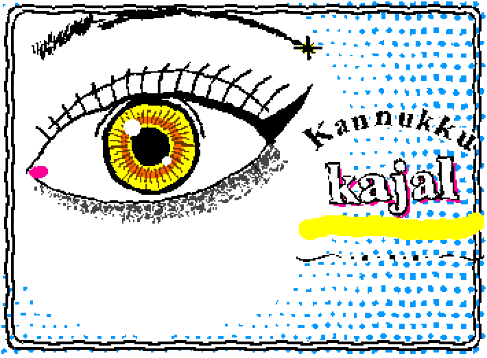
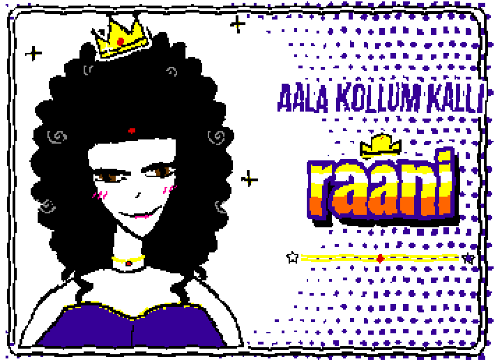
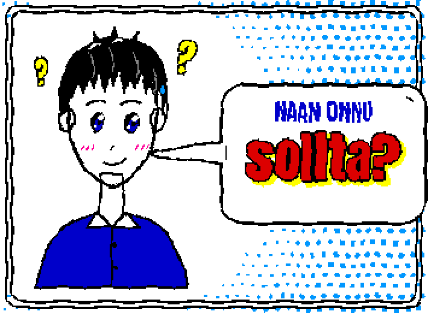
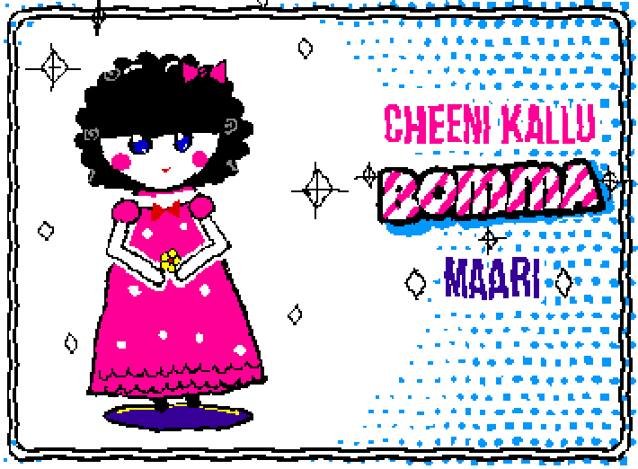
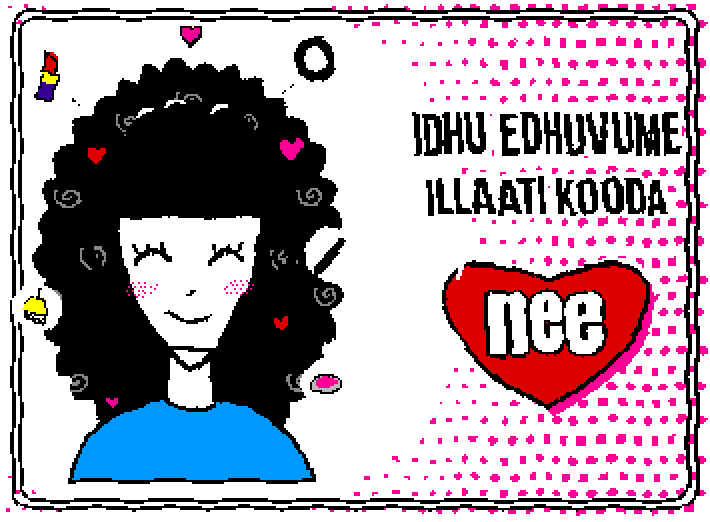
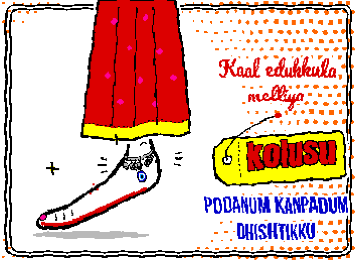

# WigglyPaint Studio

Code-drawn, boiling-line animations for [WigglyPaint](https://internet-janitor.itch.io/wigglypaint).
Write a scene in plain JavaScript (canvas 2D calls), press a button, and it lands in WigglyPaint's
three animation frames with the hand-drawn wobble. Hit **EXPORT** and you have a looping GIF.

| | | |
|:-:|:-:|:-:|
|  |  |  |
|  |  |  |
|  |  |  |

All 14 lyric cards are in [`docs/gallery/`](docs/gallery). Each pairs a drawing with a lyric line
in one of 13 lettering styles, and the text works in Tamil as well as Latin script. A scene can
also be plain art with no text, like the cat in [`draw-cat.js`](draw-cat.js).

**Let your AI draw anything.** The repo ships an agent skill. Ask Claude Code (or another coding
agent) for *"a fox asleep under a lamp, wiggly"* and it writes the scene, checks it in the browser,
and adds it to the studio. See [Use it with an AI agent](#use-it-with-an-ai-agent).

## Try it

**In your browser:** <https://deepan-alve.github.io/wigglypaint-studio/>. Nothing to install.

**Locally:**

```sh
git clone https://github.com/deepan-alve/wigglypaint-studio
cd wigglypaint-studio
python3 -m http.server 8765
```

Open <http://localhost:8765/wigglypaint-studio.html>. A **WigglyPaint studio** panel floats in the
corner (drag it by its title):

1. Pick a scene.
2. For a lyric card, type or paste the lyric: a small line, a big word, and an optional last line.
   Scenes marked "(no lyric)" ignore the boxes.
3. **Draw scene**. It takes about a second.
4. Click **EXPORT** in WigglyPaint (bottom left) to save the GIF.

You can keep painting over the result with WigglyPaint's own pens before you export.

Serve it over `http://` rather than opening the file directly: the panel needs web fonts and
clipboard access, and browsers restrict both on `file://`.

## Make your own scene

A scene is one `draw-<name>.js` file. The shortest working one:

```js
const TEXT=window.WP_TEXT||{small:'',big:''};
{
const{layer,backdrop,clear,lyric,show,C:{INK,PAPER,RED,YELLOW,CYAN},PI}=lyricKit();
clear();
backdrop({color:CYAN,calm:[110,150]});            // halftone dots, calm around the subject

layer(RED,g=>{g.beginPath();g.arc(110,150,50,0,2*PI);g.fill()});      // fill
layer(INK,g=>{g.lineWidth=3;g.beginPath();g.arc(110,150,50,0,2*PI);g.stroke()});  // outline
layer(YELLOW,(g,f)=>{g.fillRect(150+f*3,90,8,8)});                    // moves across the 3 frames

lyric(TEXT,'poster');
show();
}
```

Leave out the `lyric(...)` call and the scene is plain art: it uses the whole canvas and draws
without any text.

To see it without a rebuild, open `wigglypaint-studio.html#run=draw-<name>.js`. The page loads
the file from disk and draws it. Edit, reload, look. When it's right, register it in `SCRIPTS`
at the top of [`build-studio.py`](build-studio.py) and rebuild:

```sh
python3 build-studio.py      # rewrites wigglypaint-studio.html
```

### The `lyricKit()` API

Everything lives in [`lyric-lib.js`](lyric-lib.js). Coordinates are deck pixels: the deck is
512×342 and the drawing area sits at (5,22), 355×261. On a lyric card the text column is on the
right (x ≈ 200–356), so put the drawing on the left. Plain art can use the whole area.

| Call | What it does |
|---|---|
| `layer(colour, (g, frame) => …)` | Draw with any canvas 2D calls on `g`. Every pixel you cover becomes `colour` in each of the 3 frames, each through its own wobble field. That wobble is what makes the lines boil. `frame` is 0–2, so randomness and motion differ per frame. Pass `{onlyEmpty:true}` to paint only blank pixels. |
| `clear()` | Blank all three frames. |
| `backdrop({color, calm, step, max, border})` | Halftone dot background that grows away from the `calm` point, plus a wobbly double border. |
| `lyric(TEXT, style)` | Set the lyric. `style` is a name, or `{style, colors:{…, box:[x0,x1]}}` to recolour it and move the text column. |
| `show()` | Push the frames to the screen. Call it last. |
| `bez(p0,p1,p2,p3)` | Cubic Bézier as a function `t → [x,y]`. |
| `trace(g, f, n, from, to, join)` | Walk a curve function into the current path. |
| `normal(f, t)` | Unit normal of a curve at `t`. Useful for lashes, hair, and thickness. |
| `C` | Palette: `INK PAPER WHITE YELLOW ORANGE RED PINK PURPLE BLUE CYAN GREEN DKGREEN BROWN TAN LGRAY GRAY DGRAY`. |
| `rnd(a,b)`, `PI`, `W`, `H`, `OX`, `OY` | Helpers and canvas geometry. |

**Lyric styles:** `arc` (default), `poster`, `script`, `banner`, `tag`, `panel`, `kolam`,
`wave`, `bubble` (set `colors.point:[x,y]` to aim the speech tail), `heart`, `candy`,
`jasmine`, `royal`, `mystic`. Look at the `draw-*.js` file that uses a style to see its colour keys.

**Layering:** later layers paint over earlier ones, so work back to front. Use fills first,
then shading, then `INK` outlines on top. A `PAPER` layer erases, which is how the eye white
in `draw-kajal.js` keeps the background dots out.

### The other mode: driving the mouse

`draw-apple.js`, `draw-pup.js` and `draw-robot.js` work differently. They fire synthetic mouse
events, so WigglyPaint's own pens and markers draw the strokes. It's slower (about 15 seconds,
and the page freezes while it runs), but the result is real WigglyPaint brushwork. These appear
in the panel as "(slow, no lyric)". You can also paste them straight into the devtools console
of plain `wigglypaint.html`.

## Use it with an AI agent

[`.claude/skills/wigglypaint-art/SKILL.md`](.claude/skills/wigglypaint-art/SKILL.md) teaches an
AI coding agent the whole workflow: plan the picture, write the scene, open it with `#run=`,
look at a screenshot, fix it, then register and build. Ask for anything in plain words, like
*"a cat holding a coffee cup"* or *"a lighthouse in a storm, with the lyric 'hold on | tonight'"*.

- **Claude Code, inside this repo:** nothing to install. Claude Code loads skills from
  `.claude/skills/` automatically.
- **Claude Code, anywhere:** install it globally. When you ask for wiggly art outside a checkout,
  the skill clones the studio first.

  ```sh
  npx skills add deepan-alve/wigglypaint-studio
  ```

- **Other agents** (Codex, Cursor, Gemini CLI, …): [`AGENTS.md`](AGENTS.md) points them to the same
  instructions. The `npx skills` command above also installs for many of them.

The skill tells agents to draw original subjects, not copyrighted characters or logos.

## Exporting for video

[`build_videos.sh`](build_videos.sh) turns exported frames (`export/<scene>/f0.png`–`f2.png`)
into a 4× ProRes `.mov`, upscaled PNGs, and a preview GIF for each scene. All scaling is
nearest-neighbour, so the pixels stay crisp in an editor. It needs `ffmpeg`.
[`upload_server.py`](upload_server.py) is a tiny local endpoint (port 8899) that writes
base64 POSTs into `export/`, for saving frames from the browser.

## Repo map

| Path | |
|---|---|
| `wigglypaint-studio.html` | The built page: WigglyPaint plus the studio panel. This is the only file you need to open. |
| `wigglypaint.html` | Original WigglyPaint, untouched |
| `build-studio.py` | Builds the studio from the original + `lyric-lib.js` + `draw-*.js` + `lyrics.json` |
| `lyric-lib.js` | `lyricKit()`: layers, wobble, backdrop, and the 13 lyric styles |
| `draw-*.js` | One file per scene |
| `.claude/skills/wigglypaint-art/` | The agent skill. `AGENTS.md` points other agents to it |
| `lyrics.json` / `lyrics.txt` | Default lyrics baked in at build time. `lyrics.txt` (git-ignored) takes one line per scene, `small \| big \| tail`. |
| `scripts/`, `extract.py` | WigglyPaint's internal Lil scripts, split out for reading |

## Credits

[WigglyPaint](https://internet-janitor.itch.io/wigglypaint) is by **John Earnest**, built in
[Decker](https://beyondloom.com/decker/). Its code is MIT and its assets are CC0. It's bundled
here unmodified, apart from removing the itch.io embed helper. Please support the original.

The studio, the library, and the scenes are MIT; see [LICENSE](LICENSE).
